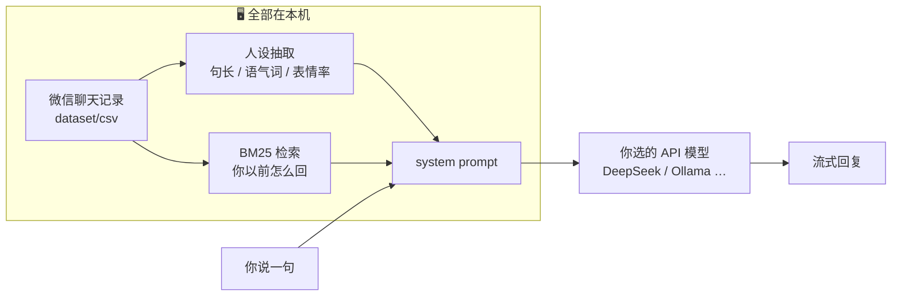
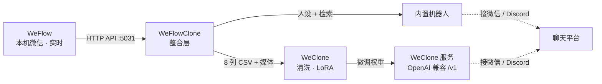

<p align="center">
  
</p>

<h1 align="center">WeFlowClone</h1>

<p align="center">
  <b>用微信聊天记录，造一个「像你」的数字分身</b><br/>
  <sub>数据留在本机 · 不训练也能用 · 想更像再微调</sub>
</p>

<p align="center">
  <a href="../../releases"></a>
  <a href="../../actions/workflows/ci.yml"></a>
  <a href="LICENSE"></a>
  
  
  
</p>

<p align="center">
  <a href="../../releases"><b>⬇️ 下载安装包</b></a> ·
  <a href="docs/02-快速开始.md">🚀 快速开始</a> ·
  <a href="docs/01-架构设计.md">🏗 架构</a> ·
  <a href="docs/09-内置机器人.md">🤖 机器人调优</a> ·
  <a href="CONTRIBUTING.md">🛠 参与开发</a>
</p>

---

## ✨ 这是什么

**WeFlow** 负责「把你的微信聊天记录读出来」，**WeClone** 负责「把你的说话方式学进去」，
中间那段——导出什么格式、放哪、图片怎么办、新消息怎么补——原本要手工干。

**WeFlowClone 就是中间这段**，而且把它做成了两条腿走路：

<table>
<tr>
<td width="50%" valign="top">

<h3>🟢 只想用</h3>
<p>下载安装包 → 双击 → 在网页里填一个 API Key → 直接聊天。</p>
<ul>
  <li>不需要 Python</li>
  <li>不需要显卡</li>
  <li>不需要训练</li>
  <li>支持 DeepSeek / 通义 / Moonshot / OpenAI / 本地 Ollama</li>
</ul>

</td>
<td width="50%" valign="top">

<h3>🔵 想更像</h3>
<p>接上 WeFlow，一条命令把聊天记录变成训练数据，再用 LoRA 微调。</p>
<ul>
  <li><code>wfc pull</code> 自动拉取 + 转格式</li>
  <li><code>wfc prepare</code> 训练前先体检</li>
  <li><code>wfc train</code> 一键微调</li>
  <li><code>wfc serve</code> 起服务接微信 / Discord</li>
</ul>

</td>
</tr>
</table>

---

## 🚀 三分钟开始

### 方式一：下载即用（推荐给普通用户）

1. 去 **[Releases](../../releases)** 下载对应平台的包：

   | 平台 | 文件 |
   | --- | --- |
   | Windows 10/11 | `WeFlowClone-*-win64.zip` → 解压 → 双击 `WeFlowClone\WeFlowClone.exe` |
   | macOS（M 系列） | `WeFlowClone-*-macos-arm64.dmg` → 拖进「应用程序」 |
   | macOS（Intel） | `WeFlowClone-*-macos-x86_64.dmg` → 拖进「应用程序」 |

2. 浏览器会自动打开 `http://127.0.0.1:8765`；没打开就手动访问。
3. 右上角 **设置** → 填 **API 地址 / API Key / 模型名** → **测试连接** → **保存** → 开聊。

> 想让它「像你」：装好 [WeFlow](https://github.com/hicccc77/WeFlow) 并开启 API 服务，
> 设置 `WEFLOW_TOKEN`，然后 `WeFlowClone.exe pull` + `WeFlowClone.exe bot --reindex`。

### 方式二：从源码跑（开发者 / 要训练）

```powershell
git clone https://github.com/lhongjie70-sudo/WeFlowClone.git
cd WeFlowClone
py -3.12 -m venv .venv
.\.venv\Scripts\Activate.ps1
pip install -e .

wfc demo     # 用内置假数据跑通全链路（不需要微信 / 显卡）
wfc bot      # 启动内置机器人
```

训练另需显卡与 `scripts/setup.ps1`，见 [docs/05-训练与部署.md](docs/05-训练与部署.md)。

---

## 🧠 为什么「不训练也能像」

通用大模型的毛病不是不会聊天，而是**话太长、太客气、太爱总结**。
你的聊天记录恰好能纠正这三点：



- **人设**：平均 9 个字、68% 不超过 8 字、常用「啊/吧/呢」、17% 带表情 → 写进 system prompt；
- **检索**：从历史里找 2~3 段「对方问 → 你答」当 few-shot，锚定具体答法；
- **模型**：只负责「生成」，不接触你的原始数据，只有最终请求发出去。

调参细节：[docs/09-内置机器人.md](docs/09-内置机器人.md)

---

## 🏗 它是怎么拼起来的



**两条设计红线**：

- **零改动上游**：`vendor/WeClone` 一行不改，靠 `cwd` + 绝对路径配置调用，升级只换目录；
- **不打包 WeFlow**：只走它的本地 HTTP API，许可证边界清晰。

更多取舍见 [docs/01-架构设计.md](docs/01-架构设计.md)。

---

## 📦 命令一览

| 命令 | 作用 | 需要显卡 |
| --- | --- | :---: |
| `wfc doctor` | 四类自检：环境 / WeFlow / WeClone / 数据 | — |
| `wfc pull` | 从 WeFlow 拉取聊天记录 → WeClone 数据集 | — |
| `wfc import <路径>` | 导入 WeFlow 手工导出（CSV / ChatLab / JSON） | — |
| `wfc status` | 数据集统计（会话、消息、我方/对方、图片） | — |
| `wfc prepare` | 训练前体检：表头 / 类型 / 时间 / 图片 | — |
| `wfc bot` | **内置机器人**（网页 + OpenAI 兼容接口） | — |
| `wfc watch` | 监听 WeFlow 推送，自动增量同步 | — |
| `wfc prepare --make-dataset` | 生成 SFT 训练数据 | — |
| `wfc train` | LoRA 微调 | ✅ |
| `wfc serve` | 起微调后的服务 | ✅ |
| `wfc demo` | 用模拟 WeFlow 演示全链路 | — |

<details>
<summary><b>常用参数（点击展开）</b></summary>

```powershell
wfc pull --session 张三        # 只拉一个人（可写多次）
wfc pull --since 2024-01-01   # 只要这段时间之后
wfc pull --groups             # 连群聊一起拉
wfc pull --no-media           # 只要文字
wfc pull --dry-run            # 只看看会拉哪些会话
wfc bot --port 8800           # 换端口（默认 8765）
wfc bot --host 0.0.0.0        # 局域网可访问（注意安全）
```

</details>

---

## 🔒 数据契约（最重要的一张表）

WeClone 读的就是这 8 列，`wfc pull` 会自动生成：

```csv
id,MsgSvrID,type_name,is_sender,talker,msg,src,CreateTime
1,7310000000000000000,text,0,老张,在吗？,,2024-08-16 09:00:00
2,7310000000000000001,text,1,我,在的,,"2024-08-16 09:01:00"
3,7310000000000000002,image,0,老张,[图片],images/photo.png,2024-08-16 09:02:00
```

| 列 | 含义 | 处理方式 |
| --- | --- | --- |
| `type_name` | 消息类型 | `localType` → `text/image/voice/video/sticker/file/location` |
| `is_sender` | 谁说的 | 1 = 我，0 = 对方（ChatLab 导入用 `ownerId` 反推） |
| `talker` | 发送者展示名 | 我 → 「我」；对方 → 备注 / 群昵称 / 会话名 |
| `src` | 媒体路径 | 只写 `images/<文件名>`，WeClone 用 basename 匹配 |
| `CreateTime` | 时间 | 本机时区 `YYYY-MM-DD HH:MM:SS`，可切 ISO |

会话目录下还会写 `users.json`（备注 / 关系），WeClone 用它填 `chat_with`。
字段级细节：[docs/03-数据流与字段映射.md](docs/03-数据流与字段映射.md)

---

## 🧩 项目结构

```
WeFlowClone/
├─ weflow_clone/          整合层（纯标准库）
│  ├─ weflow/             API 客户端 · 字段映射 · 导出/导入
│  ├─ pipeline/           配置生成 · 数据集校验 · 自检 · 调用 WeClone
│  ├─ bot/                内置机器人（人设 / 检索 / LLM / 网页）
│  └─ tools/              模拟 WeFlow + 合成数据（测试用）
├─ vendor/WeClone/        WeClone 上游源码（未修改）
├─ packaging/             PyInstaller 规格 + 双平台构建 + 图标
├─ scripts/               安装 · 启动 · 发布闸门 · 版本升级
├─ docs/                  10 篇设计与使用文档
└─ tests/                 93 项测试（含端到端）
```

---

## ❓ 常见问题

<details>
<summary><b>安装包打不开 / 被拦截怎么办？</b></summary>

- Windows：提示「已保护你的电脑」→ **更多信息 → 仍要运行**；若被占用，先 `Get-Process WeFlowClone | Stop-Process`；
- macOS：右键 → **打开**；或 `xattr -dr com.apple.quarantine /Applications/WeFlowClone.app`；
- 启动失败看 `%LOCALAPPDATA%\WeFlowClone\logs\crash.log`（macOS 在 `~/Library/Application Support/WeFlowClone/logs/`）。

</details>

<details>
<summary><b>端口 8765 被占用？</b></summary>

```powershell
WeFlowClone.exe bot --port 8800
```

或先关掉已在运行的实例。

</details>

<details>
<summary><b>机器人「不像我」？</b></summary>

1. 先 `wfc pull` 拉数据，再 `wfc bot --reindex`；
2. 提高「参考条数」（设置页，默认 3）；
3. 换更强的模型；温度 0.8~0.9；
4. 在「额外要求」里写死你的口头禅禁忌。

</details>

<details>
<summary><b>WeFlow 连不上 / 401？</b></summary>

- WeFlow → 设置 → **API 服务** → 启动（默认 `5031`）；
- Token 填进 `weflow.jsonc`，或设 `WEFLOW_TOKEN` 环境变量（设置后要**重开终端**）；
- 自检：`wfc doctor`，会直接告诉你缺哪一项。

</details>

更多：[docs/06-常见问题.md](docs/06-常见问题.md)

---

## 📚 文档

| 文档 | 内容 |
| --- | --- |
| [快速开始](docs/02-快速开始.md) | 从零到分身跑起来 |
| [架构设计](docs/01-架构设计.md) | 分层、零改动、关键取舍 |
| [数据流与字段映射](docs/03-数据流与字段映射.md) | 每个字段从哪来到哪去 |
| [WeFlow API 对接](docs/04-WeFlow-API-对接.md) | 端点、鉴权、分页、SSE |
| [训练与部署](docs/05-训练与部署.md) | 显存、模型、参数、服务化 |
| [内置机器人](docs/09-内置机器人.md) | 人设、检索、调优 |
| [打包与分发](docs/08-打包与分发.md) | Windows/macOS 产物、签名 |
| [发布前检查](docs/10-发布前检查.md) | 本地闸门 + 版本流程 |
| [与上游同步](docs/07-与上游同步.md) | WeClone/WeFlow 升级策略 |

---

## 🤝 参与

欢迎 fork 与 PR。**仓库是源码，Releases 是成品**——两条线互不影响。

```powershell
python -m unittest discover -s tests -t tests     # 测试（不需要微信/显卡）
python scripts\release_check.py                   # 发布闸门
python scripts\bump_version.py 1.0.2              # 一处改版本
```

改造点、代码约定、PR 清单见 [CONTRIBUTING.md](CONTRIBUTING.md)。

---

## 📄 许可

本项目 **AGPL-3.0**（[LICENSE](LICENSE)）。

- [WeClone](https://github.com/xming521/WeClone)：AGPL-3.0，源码位于 `vendor/WeClone`，未修改；
- [WeFlow](https://github.com/hicccc77/WeFlow)：**CC BY-NC-SA 4.0（禁止商用）**，本项目仅通过其本地 HTTP API 对接，未分发其源码。

因此**本项目整体不可用于商业用途**；fork 后分发（含作为网络服务运行）需以 AGPL-3.0 公开源码。
详见 [NOTICE.md](NOTICE.md)。

---

<p align="center">
  <sub>请负责任地使用：只处理你自己有权使用的聊天记录，遵守当地法律法规。</sub>
</p>
